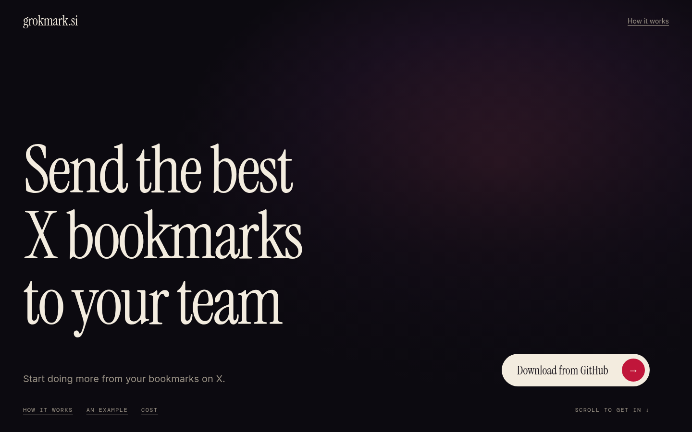
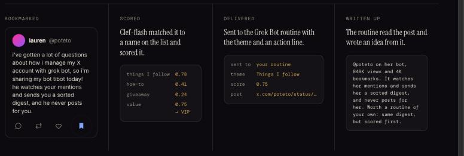

# Grokmark

Only your best bookmarks get seen. It runs inside Chrome while you browse.

[](https://grokmark.si)

See it at **[grokmark.si](https://grokmark.si)**.

Grokmark is an open-source Chrome extension (Manifest V3). While you are on x.com it scores your new X bookmarks with Cloudflare's **Clef-flash** decision model, decides in plain code whether each one is a very important post, a VIP, and sends only the VIPs to your **Grok Bot** routine webhook (a Slack incoming webhook works too). No X developer app, no server, no X API bill. Nothing leaves your machine except the scoring call to Cloudflare and the VIPs you send to your own routine.

> **Heads up:** Grokmark reads your bookmarks the same way x.com does in your browser, through your own logged-in session, with no password or API key. That isn't an official X API, so X could change or limit it. An optional official X API mode is available now under Advanced: connect your own X developer app (see [Setup](docs/setup.md#optional-official-x-api)). Grokmark isn't on the Chrome Web Store; install it from this repo.



## Two ways to read bookmarks

- **Your x.com session (default).** Needs an x.com tab open and nothing else: no developer app, no API bill.
- **The official X API (optional).** Under Setup > Advanced, paste the Client ID of your own X developer app and click **Connect X**. Bookmarks are then read through the API with no x.com tab open. X bills API reads to your X developer account. Turn on **API only** if Grokmark must never use your x.com session; otherwise a lost X sign-in falls back to the session for that run. See [Setup](docs/setup.md#optional-official-x-api).

## Install

1. Download the latest `grokmark-x.y.z.zip` from [Releases](https://github.com/liminalprompt/grokmark/releases/latest) and unzip it. Or clone the repository; the built extension is the `dist/` folder, no build needed.
2. Open `chrome://extensions`, turn on **Developer mode**, click **Load unpacked**, and choose the unzipped folder.
3. Click the Grokmark icon, then **Open setup**.

## Setup (three steps)

1. **Cloudflare.** Create an API token scoped to **Workers AI only** and note your account ID. Paste both. Set a usage alert in Cloudflare; a text-only bookmark costs about $0.00003.
2. **About you.** One sentence on what you build, the tools you use every day and what you want to learn. Then the names you follow, separated by commas: products, tools, companies, people. Add a few words in brackets for anything obscure, for example `Jev (TypeSafe's small decision model)`. The bouncer reads this before judging every bookmark.
3. **Grok Bot webhook.** Paste the webhook URL and key from the routine's Webhook section in the Grok Bot desktop app. Click **Send a test ping** and watch the routine fire.

Save. Then open an x.com tab and click **Test on last 10 bookmarks**: it shows each verdict and score and sends nothing. If you agree with the verdicts, click **Send these VIPs to the webhook now** to see the whole loop. Mark any verdict you disagree with; the marks build a tuning prompt (under Advanced) for the AI you already use.

Grokmark's stock VIP List covers launches and releases, AI agents that ship, how-tos, numbers and benchmarks, model and API news, research and reply openings, plus a **Names I follow** theme built from your names. Skip rules drop engagement bait, ads and giveaways, memes, recycled listicles and crypto.

### Advanced

Open the **Advanced** fold on the setup page for:

- The official X API. Connect your own X developer app to read bookmarks without your x.com session.
- More routes. Add a route, paste its webhook, and choose which themes go there. Every theme goes to the basic webhook unless you say otherwise.
- Your own VIP List. Click **Copy the VIP List prompt** (the text lives in [`src/prompt.ts`](src/prompt.ts)), run it in your AI, and paste the JSON it returns. It replaces the stock list.
- Door Policy. Score threshold, batch size, opening time, cooldown.

## Docs

- [Install](docs/install.md): get it into Chrome and keep it updated.
- [Setup](docs/setup.md): the three steps, with examples of what to write.
- [How it works](docs/how-it-works.md): what happens between a bookmark and your routine.
- [Tuning](docs/tuning.md): fix a wrong verdict, from a missing name to your own VIP List.
- [The Grok Bot routine](docs/grok-bot-routine.md): what arrives and a prompt to paste in.
- [Troubleshooting](docs/troubleshooting.md): every message Grokmark shows, and what to do.
- [Privacy and security](docs/privacy-and-security.md): what leaves your computer and where keys live.
- [Permissions](docs/permissions.md): what the extension is allowed to do and reach, and how to verify a release.

## Security and trust

- [Permissions and network access](docs/permissions.md): every permission in the manifest and every host the code can reach, with the test that pins them.
- Three permissions: storage, alarms and identity (only for the optional X sign-in window). No access to tabs, history, cookies or other sites.
- No runtime dependencies. The build bundles the TypeScript in this repo and nothing else.
- Releases are built by GitHub Actions from the tagged source, with a SHA-256 and a signed build attestation. The built `dist/` folder is committed too, and CI fails if it drifts from the source, so a plain clone loads into Chrome without a build.
- CodeQL and Dependabot run on the repository.
- [Privacy and security](docs/privacy-and-security.md) covers what leaves your computer and where keys live.

## How it decides

For each new bookmark, one Clef-flash request asks every skip rule and theme as a yes/no question and the value as a score question over the levels archive / keep / vip.

1. Any skip rule above 0.6 → archive.
2. No theme above 0.3 → archive.
3. Normalized value (score ÷ (levels − 1)) at or above the threshold (default 0.5) → **VIP**, filed under the highest-weight matched theme.
4. Otherwise the nearest level decides keep or archive.

VIPs are queued, then sent per route when the queue reaches the batch size or any VIP has waited 24 hours. **Run now** in the popup sends whatever is queued at once. Posts are sent as links plus the theme and an action line, with an instruction to ignore anything inside them.

## When it runs

A check starts only if the three setup steps are done, local time is past the opening time, the last successful check is older than the cooldown (default 4 hours), and no check is running. A content script on x.com signals your visit, and an alarm re-checks every 30 minutes while Chrome is open. In the default session mode Grokmark needs an x.com tab open to read bookmarks. With the official X API connected it needs no tab: the alarm alone is enough while Chrome is open.

## Development

```bash
npm test
npm run typecheck
npm run build    # writes dist/
```

Everything that touches X's web app lives in `src/fetchBookmarks.ts`, everything that touches X's official API in `src/xApi.ts`, and `src/source.ts` chooses between them; everything that touches Clef's response shape lives in `parseResponse` in `src/clef.ts`; the stock VIP List is `src/stockRubric.ts` and `src/effectiveList.ts` decides which list runs. The landing page is `site/`, served by the `landing` preview.

## Author

Made by Liminal Prompt. Follow [@liminalprompt on X](https://x.com/liminalprompt).

## License

MIT. See [LICENSE](LICENSE).
